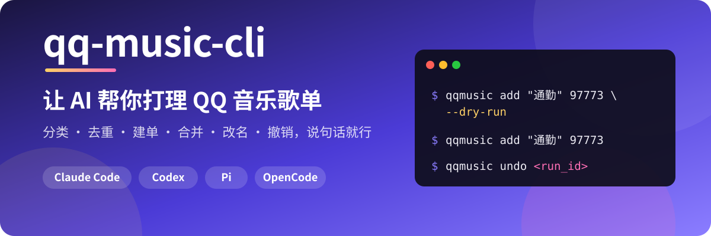

<div align="center">



<br>

[](LICENSE)


[](https://jinhuang712.github.io/qq-music-cli/)

**🎧 对 agent 说一句话，整理好你的 QQ 音乐曲库。每一次改动，都能先预演、再撤销。**

</div>

`qqmusic` 是管理你自己 QQ 音乐账号的命令行工具，也是 Claude Code、Codex、Pi、OpenCode 的插件。它只处理歌单信息，不播放，也不下载音频。

> [!NOTE]
> 这是个人做的开源项目，和腾讯、QQ 音乐没有关系。它用的是 y.qq.com 网页版自己在用的接口，网页改版后可能要跟着更新。建议只用来管理你自己的账号。

## ✨ 能做什么

装好之后，先加载 skill，再对 agent 说你想做的事：

|             | 你可以这样说                                                                                                                                 |
| ----------- | -------------------------------------------------------------------------------------------------------------------------------------------- |
| 🗂️ **整理** | 「请你帮我给所有的歌曲分类」<br>「找到散落在歌单中重复的歌曲」<br>「同一首歌收了好几个版本，帮我只留录音室版」                               |
| 🆕 **新建** | 「做一个下雨天听的华语 R&B 歌单，30 首左右」<br>「帮我把周杰伦的所有热门歌曲都加到一个新的歌单中」<br>「把《叶惠美》整张专辑加进一个新歌单」 |
| 🔍 **了解** | 「分析一下我最喜欢的音乐曲风」<br>「我收藏的歌里哪些是 city pop？」<br>「这首歌的热评都在说什么？」                                          |
| 🛠️ **管理** | 「把『RAP』歌单改名成『说唱』」<br>「把『通勤』和『开车』合并成一个歌单」<br>「刚才那次改动帮我撤销掉」                                      |

> [!TIP]
> 🛡️ **改动之前，agent 会先给你看方案并预演一遍；改完之后，每次改动都能撤销。**
> 所有写命令都有 `--dry-run`，每次真的改了东西都会留下记录，用 `qqmusic undo <run_id>` 还原。

所有功能、每个功能的状态和出错时的表现：[FEATURES.md](FEATURES.md)。

## 🚀 安装

按你用的 agent 选一条运行。插件和 `qqmusic` 会一起装好，重复运行就是更新：

```sh
# Claude Code
curl -fsSL https://raw.githubusercontent.com/jinhuang712/qq-music-cli/master/install-claude.sh | bash
# Codex
curl -fsSL https://raw.githubusercontent.com/jinhuang712/qq-music-cli/master/install-codex.sh | bash
# Pi
curl -fsSL https://raw.githubusercontent.com/jinhuang712/qq-music-cli/master/install-pi.sh | bash
# OpenCode
curl -fsSL https://raw.githubusercontent.com/jinhuang712/qq-music-cli/master/install-opencode.sh | bash
```

不想用脚本，或者要卸载：[INSTALL.md](INSTALL.md)。

## 🎬 开始用

**1. 加载 skill。** 装好后新开一个会话，手动加载。它不会自己加载：

| Agent       | 加载方式                               |
| ----------- | -------------------------------------- |
| Claude Code | `/qq-music:cli`                        |
| Codex       | `$qq-music:cli`                        |
| Pi          | `/skill:qq-music-cli`                  |
| OpenCode    | 对 agent 说「加载 qq-music-cli skill」 |

只加载、不带要求时，agent 会先列出它能做的事。也可以把要求直接写在后面，比如 `/qq-music:cli 我有几个歌单`。

**2. 扫码登录。** 第一次使用时，agent 会弹出一个显示二维码的小窗口，用微信或 QQ 扫码即可。扫码是唯一需要你动手的步骤。

## ⌨️ 直接用命令行

```sh
qqmusic login --wechat              # 扫码登录
qqmusic playlists                   # 我的歌单
qqmusic show liked                  # 「我喜欢」里的歌
qqmusic search "晴天 周杰伦"          # 搜索
qqmusic add "通勤" 97773 --dry-run   # 先预演，再去掉 --dry-run 真正加歌
qqmusic undo <run_id>               # 撤销某次改动
```

全部命令、参数和退出码：[CLI.md](CLI.md)。用法和注意事项：[USAGE.md](USAGE.md)。

## ⚠️ 已知限制

> [!IMPORTANT]
>
> - **只支持 macOS。** 登录窗口和钥匙串都依赖 macOS。
> - **接口可能随网页改版失效。** 它用的是网页版现在的明文接口，不是官方开放接口。
> - **只管你自己的账号。** 改歌单的命令只接受你自己的歌单。
> - **有些事做不了**，比如关注歌手、调整歌单里的歌曲顺序。完整的清单和理由见 [FEATURES.md → Not planned](FEATURES.md#not-planned)。

## 📚 文档

| 文档                               | 回答什么                       |
| ---------------------------------- | ------------------------------ |
| [FEATURES.md](FEATURES.md)         | 它做什么、做到哪一步、不做什么 |
| [INSTALL.md](INSTALL.md)           | 各 agent 的安装、更新和卸载    |
| [USAGE.md](USAGE.md)               | 怎么用，注意什么               |
| [CLI.md](CLI.md)                   | 每条命令的查阅表               |
| [HOW-IT-WORKS.md](HOW-IT-WORKS.md) | 接口原理、登录和插件结构       |
| [DEVELOPMENT.md](DEVELOPMENT.md)   | 开发、实测和发布的约定         |
| [CHANGELOG.md](CHANGELOG.md)       | 每个版本改了什么               |
| [TODO.md](TODO.md)                 | 还没排期的待办和待定问题       |

## 🙏 致谢

> 感谢以下项目的一些启发

- [L-1124/QQMusicApi](https://github.com/L-1124/QQMusicApi)
- [baoozak/qqmusic-mcp](https://github.com/baoozak/qqmusic-mcp)
- [tencentmusic/qqmusic-skills](https://github.com/tencentmusic/qqmusic-skills)

## 📄 License

[MIT](LICENSE)
